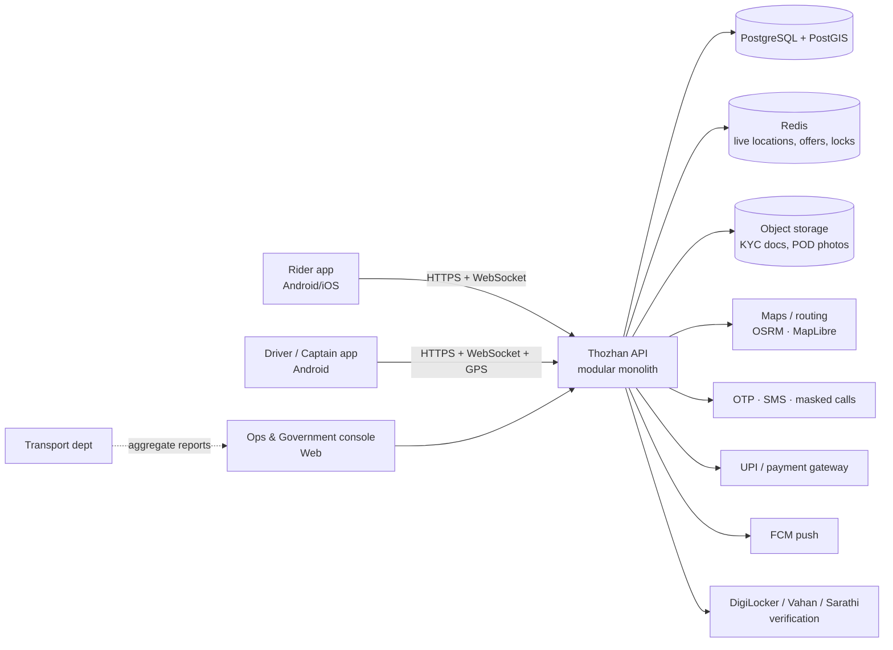

# Thozhan system architecture — Auto, Bike, Cab, Parcel

Version 0.1, 3 November 2026. This is the target architecture. What exists in the repository today is listed in [IMPLEMENTATION_STATUS.md](IMPLEMENTATION_STATUS.md).

## 1. Design principles

1. **One core, many services.** Auto, bike taxi, cab and parcel share identity, location, pricing, dispatch, payments, safety and support. A service is mostly *configuration*: its tariff, vehicle rules, state machine and feature flag. Each service is not a separate app or backend.
2. **The tariff is data, not code.** Each service category has versioned tariff rules with a legal status (`OFFICIAL`, `PENDING_APPROVAL`, `ILLUSTRATIVE`). Only `OFFICIAL` tariffs are allowed for real billing.
3. **One fare engine, run everywhere.** The same TypeScript package calculates the fare in the rider app (offline virtual meter), on the server (authoritative final fare) and in the government verifier page.
4. **Legality gates.** A service or zone only switches on when its legal status allows it. Bike taxi and parcel start behind flags.
5. **Tamil first.** Every user-facing string comes from the i18n catalogue in Tamil and English. Receipts and notifications are bilingual.
6. **Money in paise, time in UTC, display in IST.** Use integer paise everywhere, and store a tariff snapshot on every quote and trip.
7. **Modular monolith first.** Build one deployable API with strict module boundaries and an event outbox. Split out a service (dispatch is the likely first) only when load measurements demand it.

## 2. Context



## 3. Service catalogue

| Service | Categories | Vehicle | Tariff source | Launch gate |
| --- | --- | --- | --- | --- |
| **Auto** | `auto` | 3-wheeler, contract carriage permit | G.O. Ms. 366 / 2026 (verified) | Pilot zone approval |
| **Virtual meter** | `auto` (street hail) | Any auto; registered driver optional | Same as auto | Field accuracy report |
| **Bike taxi** | `bike` | 2-wheeler, commercial registration where required | **None published**; `PENDING_APPROVAL` | Explicit state permission |
| **Cab** | `cab-mini`, `cab-sedan`, `cab-suv` | 4-wheeler taxi permit | Not yet sourced; `PENDING_APPROVAL` | Tariff + permit confirmation |
| **Parcel** | `parcel-bike`, `parcel-auto` | 2W/3W | Commercial (not regulated like passenger fare); `ILLUSTRATIVE` until priced | Goods-carriage legality, item policy |

Each category declares the following:
- its **tariff rule IDs**
- its **trip flow**: `ride`, `meter` or `delivery`
- **driver requirements**: licence class, permit type and badge
- **features**: OTP at start, OTP at drop, proof-of-delivery photo, ghat support, women-only option, and similar
- **legal status and feature flag**

See `packages/shared/src/services.ts`.

## 4. Backend modules

| Module | Responsibility | Key data |
| --- | --- | --- |
| **identity** | Phone OTP login, sessions, roles (rider, driver, fleet owner, ops, gov-viewer), consent (DPDP) | User, Session, Consent |
| **driver-compliance** | Onboarding, DL/RC/insurance/permit/badge upload, verification via DigiLocker/Vahan/Sarathi, expiry alerts, suspension and appeal | Driver, Vehicle, Document, Verification |
| **catalog** | Services, categories, zones (PostGIS polygons), feature flags per zone | Service, Category, Zone, Flag |
| **tariff** | Versioned tariff rules, dual-approval workflow, scheduled activation, verifier API | TariffRule, TariffVersion, Approval |
| **quote** | Route (OSRM), distance/time estimate, fare via shared engine, signed quote with expiry | Quote (snapshot + checksum) |
| **booking** | Ride and parcel orders, idempotency keys, scheduling, cancellation policy | Booking, ParcelDetails |
| **dispatch** | Candidate search (Redis GEO + PostGIS), offer waves, atomic accept, re-dispatch on timeout | Offer, Assignment |
| **trip** | State machines (ride / meter / delivery), OTPs, GPS track ingest, final fare from engine | Trip, TripEvent, TrackPoint |
| **meter** | Street-hail sessions, device-side track sync, tamper signals, reconciliation with server distance | MeterSession |
| **ledger & payments** | ₹10/day driver fee, UPI collect/intent, refunds, payouts, double-entry ledger, reconciliation | LedgerEntry, Payment, Payout |
| **notifications** | Push, SMS, WhatsApp, Tamil/English templates | Template, Message |
| **safety** | SOS, trip share links, route-deviation detection, women-safety preferences, incident queue | Incident, ShareLink |
| **support** | Complaints, lost items, fare disputes (with GPS evidence), routing to the RTO when needed | Ticket |
| **reporting** | Aggregate, de-identified metrics for government: fare compliance, fulfilment, complaints | Materialised views |
| **audit** | Immutable log of staff actions, tariff changes and data access | AuditEvent |

Modules talk through **in-process interfaces plus domain events** (transactional outbox, then a worker queue). They do not share tables.

## 5. Trip flows

**Ride** (auto, bike, cab):
`REQUESTED → ACCEPTED → ARRIVED → IN_PROGRESS → COMPLETED`, with `CANCELLED` possible before `IN_PROGRESS`. The pickup OTP is required to start.

**Meter** (street hail, auto):
`METER_RUNNING ⇄ METER_PAUSED → COMPLETED`. It starts on the device and may run without a registered driver.

**Delivery** (parcel):
`REQUESTED → ACCEPTED → AT_PICKUP → PICKED_UP → IN_TRANSIT → AT_DROP → DELIVERED`. Failure paths are `CANCELLED` (before pickup) and `RETURNED`.
- The pickup OTP comes from the sender, and the drop OTP from the receiver.
- Proof-of-delivery photo is optional.
- Restricted item categories are declared at booking.

Transitions live in `packages/shared/src/trip-machine.ts`. The server is authoritative, and clients use the same table to render allowed actions.

## 6. Pricing pipeline

```
route (OSRM) ─┐
GPS track  ───┼─► measured inputs ─► fare engine(rule, inputs) ─► breakdown ─► quote / receipt
clock (IST) ──┘     distance m, waiting s, ride min, terrain, weight g
```

- **Quote:** estimated inputs, then a signed quote that stores `tariffVersionId` and expires after 5 minutes.
- **Final fare:** measured inputs from the server-side track, falling back to device meter data. The receipt shows every line, plus the assumptions in force (for example the rounding rule).
- **Auto:** exactly the G.O. 366 parameters.
- **Bike, cab, parcel:** same engine, with fields as each tariff needs them: per-minute ride charge, minimum fare, and weight slabs for parcels.

## 7. Dispatch

1. Drivers stream GPS every 4–10 s (adaptive) into **Redis GEO** keyed by `category:zone`.
2. On booking, search for drivers within radius *r* who are online, verified for the category, hold valid documents and are not on a trip.
3. Rank by ETA (OSRM table), with a fairness tie-break on idle time.
4. Send offers in waves of 3. The first accept wins through a Redis lock plus a Postgres row-level check. Waves expand to radius 2*r* after timeout.
5. Never assign without valid compliance documents. This check is server-side.

## 8. Virtual meter on the device

```
GPS (1 Hz, foreground service) → accuracy gate (≤25 m) → speed gate (≤80 km/h auto)
  → smoothing → distance accumulator / waiting accumulator (<5 km/h for ≥60 s)
  → fare engine (local tariff copy, version-pinned) → live fare + voice (Tamil)
  → stored locally → synced to /meter-sessions when online
```

The core logic is pure TypeScript in `packages/meter`. It is testable with synthetic tracks and has no device APIs.

## 9. Data and security

- **PostgreSQL 16 + PostGIS** is the source of truth. Redis holds only transient data.
- PII is encrypted at column level (phone, documents). Object storage uses signed URLs. Riders and drivers see masked phone numbers.
- Staff access needs SSO + MFA and least-privilege roles, and every access is audited.
- **DPDP Rules 2025:** consent records, purpose limitation, export/delete flows and retention schedules. Government views are aggregates only.
- OWASP MASVS for mobile: certificate pinning, root/mock-location signals, no secrets in the app.

## 10. Deployment

- Containers on a managed Kubernetes or ECS cluster in an **India region** (data residency), with Postgres managed (RDS/Cloud SQL) and point-in-time recovery.
- Environments: `dev`, `staging`, `pilot`. Tariff changes go to staging first, then are activated on a schedule.
- Observability: OpenTelemetry → Grafana (Loki/Tempo/Prometheus), Sentry for apps. Alerts on dispatch latency, failed OTPs and payment webhooks.
